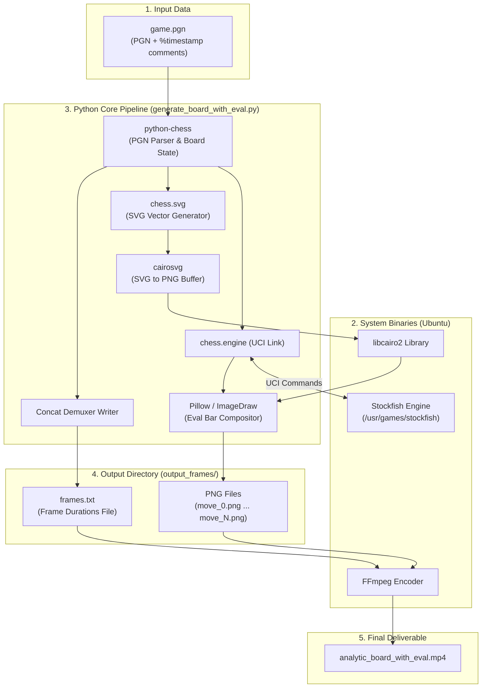
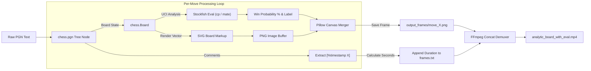
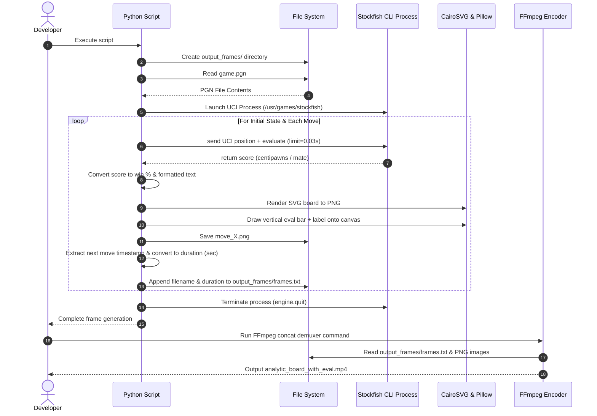
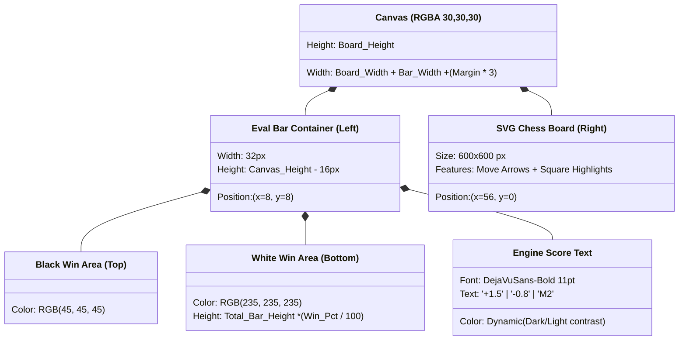
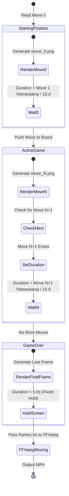

# Description
## Diagrams
### 1. High-Level System Architecture

This diagram illustrates how external binaries, Python libraries, input files, and output streams interact across the pipeline.



---

### 2. End-to-End Data Transformation Pipeline

This flowchart shows how raw move text transforms into video frames step-by-step for each move in the game.



---

### 3. Execution Sequence Diagram

This sequence diagram details the exact order of operations and inter-process communication during script execution and video rendering.



---

### 4. Image Canvas & Layout Architecture

This class diagram illustrates how individual frames are composite-assembled using Pillow (`PIL`).



---

### 5. Time Synchronization State Machine

This state machine shows how the script calculates variable frame durations from the PGN move timestamps to keep video time locked to physical move time.



# Getting Started

## Python Script

Example game.pgn
```pgn
[Event "Live Chess"]
[Site "Chess.com"]
[Date "2026.10.08"]
[Round "?"]
[White "0fajarpurnama0"]
[Black "foda89"]
[Result "1-0"]
[TimeControl "900+10"]
[WhiteElo "1637"]
[BlackElo "1566"]
[Termination "0fajarpurnama0 won by resignation"]
[ECO "E60"]
[EndTime "8:03:00 GMT+0000"]
[Link "https://www.chess.com/game/live/184993010852?username=0fajarpurnama0&move=0"]

1. d4 {[%clk 0:15:05.9][%timestamp 41]} 1... d5 {[%clk 0:15:06.4][%timestamp 36]} 2. c4 {[%clk 0:15:13.8][%timestamp 21]} 2... c6 {[%clk 0:15:09.3][%timestamp 71]} 3. Nf3 {[%clk 0:15:08.7][%timestamp 151]} 3... Nf6 {[%clk 0:15:17.7][%timestamp 16]} 4. g3 {[%clk 0:15:14.7][%timestamp 40]} 4... g6 {[%clk 0:15:23.2][%timestamp 45]} 5. Bg2 {[%clk 0:15:23.4][%timestamp 13]} 5... Bg7 {[%clk 0:15:31.7][%timestamp 15]} 6. O-O {[%clk 0:15:30.1][%timestamp 33]} 6... O-O {[%clk 0:15:40.8][%timestamp 9]} 7. Nc3 {[%clk 0:15:34.7][%timestamp 54]} 7... Re8 {[%clk 0:15:45.6][%timestamp 52]} 8. Qc2 {[%clk 0:13:23.7][%timestamp 1410]} 8... Bf5 {[%clk 0:15:16.4][%timestamp 392]} 9. Qb3 {[%clk 0:12:59.5][%timestamp 342]} 9... Qd7 {[%clk 0:13:30.2][%timestamp 1162]} 10. Ne5 {[%clk 0:11:51.7][%timestamp 778]} 10... dxc4 {[%clk 0:12:25.8][%timestamp 744]} 11. Qxc4 {[%clk 0:11:01.2][%timestamp 605]} 11... Qc7 {[%clk 0:12:02.5][%timestamp 333]} 12. Qxf7+ {[%clk 0:09:25.5][%timestamp 1057]} 12... Kh8 {[%clk 0:12:04.4][%timestamp 81]} 13. Bf4 {[%clk 0:07:32.3][%timestamp 1232]} 13... Qc8 {[%clk 0:12:09][%timestamp 54]} 14. Qb3 {[%clk 0:06:10.7][%timestamp 916]} 14... Be6 {[%clk 0:12:02.7][%timestamp 163]} 15. d5 {[%clk 0:06:03.3][%timestamp 174]} 15... Nxd5 {[%clk 0:12:01.3][%timestamp 114]} 16. Nxd5 {[%clk 0:06:13.2][%timestamp 1]} 16... cxd5 {[%clk 0:09:02.8][%timestamp 1885]} 17. Bxd5 {[%clk 0:06:23.1][%timestamp 1]} 17... Bxd5 {[%clk 0:09:03.5][%timestamp 93]} 18. Qxd5 {[%clk 0:06:33][%timestamp 1]} 18... e6 {[%clk 0:08:58.3][%timestamp 152]} 19. Qb3 {[%clk 0:04:50][%timestamp 1130]} 19... Kg8 {[%clk 0:08:29][%timestamp 393]} 20. Rac1 {[%clk 0:04:28.8][%timestamp 312]} 20... Qd8 {[%clk 0:08:28.7][%timestamp 103]} 21. Rfd1 {[%clk 0:04:06.5][%timestamp 323]} 21... Qe7 {[%clk 0:08:19.9][%timestamp 188]} 22. Rd3 {[%clk 0:01:58.4][%timestamp 1381]} 22... Na6 {[%clk 0:08:24.2][%timestamp 57]} 23. Qc3 {[%clk 0:01:48][%timestamp 204]} 23... Rac8 {[%clk 0:08:23.3][%timestamp 109]} 24. Qxc8 {[%clk 0:01:49.4][%timestamp 86]} 24... Rxc8 {[%clk 0:08:31.7][%timestamp 16]} 25. Rxc8+ {[%clk 0:01:59.3][%timestamp 1]} 25... Bf8 {[%clk 0:08:34.8][%timestamp 69]} 26. Rdd8 {[%clk 0:01:43.5][%timestamp 258]} 26... g5 {[%clk 0:07:01.6][%timestamp 1032]} 27. Rxf8+ {[%clk 0:01:40.1][%timestamp 134]} 27... Kg7 {[%clk 0:07:10.1][%timestamp 15]} 28. Rf7+ {[%clk 0:01:30.2][%timestamp 199]} 28... Qxf7 {[%clk 0:07:17.6][%timestamp 25]} 29. Nxf7 {[%clk 0:01:40.1][%timestamp 1]} 29... gxf4 {[%clk 0:07:26.4][%timestamp 12]} 30. Nd6 {[%clk 0:01:41.1][%timestamp 90]} 30... fxg3 {[%clk 0:07:23.3][%timestamp 131]} 31. hxg3 {[%clk 0:01:51][%timestamp 1]} 31... b6 {[%clk 0:07:24.3][%timestamp 90]} 32. Ra8 {[%clk 0:01:49.6][%timestamp 114]} 32... Kf6 {[%clk 0:07:29.4][%timestamp 49]} 33. Rxa7 {[%clk 0:01:55.6][%timestamp 40]} 33... Nc5 {[%clk 0:07:38.3][%timestamp 11]} 34. Rxh7 {[%clk 0:02:01.2][%timestamp 44]} 34... Ke5 {[%clk 0:07:46.8][%timestamp 15]} 35. Nc4+ {[%clk 0:02:05.7][%timestamp 55]} 35... Kd4 {[%clk 0:07:51.7][%timestamp 51]} 36. Nxb6 {[%clk 0:02:15.6][%timestamp 1]} 36... e5 {[%clk 0:07:46.6][%timestamp 151]} 37. Rh4+ {[%clk 0:02:13.2][%timestamp 124]} 37... e4 {[%clk 0:07:44.1][%timestamp 125]} 38. e3+ {[%clk 0:02:18.8][%timestamp 44]} 38... Kd3 {[%clk 0:07:49.2][%timestamp 49]} 39. b4 {[%clk 0:02:17.9][%timestamp 109]} 39... Na6 {[%clk 0:07:50][%timestamp 92]} 40. b5 {[%clk 0:02:19][%timestamp 89]} 40... Nb4 {[%clk 0:07:58.5][%timestamp 15]} 41. a4 {[%clk 0:02:27.8][%timestamp 12]} 41... Na2 {[%clk 0:07:52.8][%timestamp 157]} 42. a5 {[%clk 0:02:26.3][%timestamp 115]} 42... Nc3 {[%clk 0:08:01.7][%timestamp 11]} 43. Rh5 {[%clk 0:02:33][%timestamp 33]} 43... Ne2+ {[%clk 0:07:58.6][%timestamp 131]} 44. Kg2 {[%clk 0:02:40.3][%timestamp 27]} 44... Nc3 {[%clk 0:07:52.2][%timestamp 164]} 45. a6 {[%clk 0:02:48.3][%timestamp 20]} 45... Ke2 {[%clk 0:07:52.3][%timestamp 99]} 46. a7 {[%clk 0:02:49.4][%timestamp 89]} 46... Nd1 {[%clk 0:08:01.6][%timestamp 7]} 47. Rf5 {[%clk 0:02:58.4][%timestamp 10]} 47... Nxe3+ {[%clk 0:08:07.9][%timestamp 37]} 48. fxe3 {[%clk 0:03:06.4][%timestamp 20]} 48... Kxe3 {[%clk 0:08:17.3][%timestamp 6]} 49. a8=Q {[%clk 0:03:11.3][%timestamp 51]} 49... Kd2 {[%clk 0:08:26.5][%timestamp 8]} 50. Qxe4 {[%clk 0:03:16.4][%timestamp 49]} 1-0
```

generate_board_with_eval.py
```python
import io
import math
import os
import re
import chess
import chess.engine
import chess.pgn
import chess.svg
import cairosvg
from PIL import Image, ImageDraw, ImageFont

# Configuration
PGN_FILE = "game.pgn"
OUTPUT_DIR = "output_frames"
STOCKFISH_PATH = "/usr/games/stockfish"
DEFAULT_MOVE_DURATION = 1.0  # Fallback duration if no timing metadata exists
MIN_MOVE_DURATION = 0.2      # Minimum display time for pre-moves/instant moves

def parse_time_control(tc_header: str) -> tuple[float | None, float]:
    """Parses TimeControl header (e.g., '300' or '900+10') into (base_seconds, increment)."""
    if not tc_header or tc_header == "?":
        return None, 0.0
    
    parts = tc_header.split("+")
    try:
        base = float(parts[0])
    except ValueError:
        base = None
        
    inc = 0.0
    if len(parts) > 1:
        try:
            inc = float(parts[1])
        except ValueError:
            inc = 0.0
            
    return base, inc

def parse_clock(comment: str) -> float | None:
    """Parses [%clk HH:MM:SS] or [%clk H:MM:SS.s] into total seconds."""
    match = re.search(r'\[%clk\s+(\d+):(\d+):(\d+(?:\.\d+)?)\]', comment)
    if match:
        h, m, s = match.groups()
        return int(h) * 3600 + int(m) * 60 + float(s)
    return None

def parse_timestamp(comment: str) -> float | None:
    """Parses [%timestamp X] (tenths of a second) into total seconds."""
    match = re.search(r'\[%timestamp\s+(\d+)\]', comment)
    if match:
        return int(match.group(1)) / 10.0
    return None

def calculate_move_duration(node, turn: chess.Color, prev_clocks: dict, increment: float) -> float:
    """Calculates move duration using %timestamp, %clk delta, or fallback."""
    comment = node.comment or ""
    curr_clk = parse_clock(comment)
    ts = parse_timestamp(comment)
    
    # Calculate clock difference if %clk is available
    prev_clk = prev_clocks[turn]
    clk_duration = None
    if curr_clk is not None:
        if prev_clk is not None:
            clk_duration = prev_clk - curr_clk + increment
        # Update baseline clock for this player
        prev_clocks[turn] = curr_clk

    # Priority 1: %timestamp tag
    if ts is not None:
        return max(ts, MIN_MOVE_DURATION)

    # Priority 2: %clk delta calculation
    if clk_duration is not None:
        return max(clk_duration, MIN_MOVE_DURATION)

    # Priority 3: Default fallback
    return DEFAULT_MOVE_DURATION

def cp_to_win_percent(cp: int) -> float:
    return 50 + 50 * (2 / (1 + math.exp(-0.003682 * cp)) - 1)

def evaluate_position(board, engine) -> tuple[float, str]:
    info = engine.analyse(board, chess.engine.Limit(time=0.03))
    score = info["score"].white()
    
    if score.is_mate():
        mate = score.mate()
        win_pct = 100.0 if mate > 0 else 0.0
        text = f"M{abs(mate)}" if mate > 0 else f"-M{abs(mate)}"
    else:
        cp = score.score()
        win_pct = cp_to_win_percent(cp)
        val = cp / 100.0
        text = f"+{val:.1f}" if val >= 0 else f"{val:.1f}"
        
    return win_pct, text

def render_frame_with_bar(svg_data: str, win_pct: float, eval_text: str, output_path: str):
    board_png = cairosvg.svg2png(bytestring=svg_data.encode('utf-8'))
    board_img = Image.open(io.BytesIO(board_png))
    
    board_w, board_h = board_img.size
    bar_width = 32
    margin = 8
    total_w = board_w + bar_width + (margin * 3)
    total_h = board_h
    
    canvas = Image.new("RGBA", (total_w, total_h), (30, 30, 30, 255))
    canvas.paste(board_img, (bar_width + margin * 2, 0))
    
    draw = ImageDraw.Draw(canvas)
    x0, y0 = margin, margin
    x1, y1 = margin + bar_width, total_h - margin
    bar_height = y1 - y0
    
    white_h = int(bar_height * (win_pct / 100.0))
    
    draw.rectangle([x0, y0, x1, y1], fill=(45, 45, 45))
    draw.rectangle([x0, y1 - white_h, x1, y1], fill=(235, 235, 235))
    draw.rectangle([x0, y0, x1, y1], outline=(120, 120, 120), width=1)
    
    try:
        font = ImageFont.truetype("/usr/share/fonts/truetype/dejavu/DejaVuSans-Bold.ttf", 11)
    except OSError:
        font = ImageFont.load_default()
        
    text_color = (10, 10, 10) if win_pct > 50 else (240, 240, 240)
    text_y = y1 - white_h - 14 if win_pct > 50 else y0 + 4
    text_y = max(y0 + 2, min(text_y, y1 - 14))
    
    draw.text((x0 + 2, text_y), eval_text, fill=text_color, font=font)
    canvas.save(output_path)

def main():
    if not os.path.exists(PGN_FILE):
        print(f"Error: {PGN_FILE} not found!")
        return

    os.makedirs(OUTPUT_DIR, exist_ok=True)
    
    with open(PGN_FILE, "r", encoding="utf-8", errors="ignore") as f:
        game = chess.pgn.read_game(f)
        
    if not game:
        print(f"Error: Unable to parse PGN from {PGN_FILE}")
        return

    # Parse initial clock and increment from PGN headers
    tc_header = game.headers.get("TimeControl", "")
    base_time, increment = parse_time_control(tc_header)
    
    prev_clocks = {
        chess.WHITE: base_time,
        chess.BLACK: base_time
    }

    engine = chess.engine.SimpleEngine.popen_uci(STOCKFISH_PATH)
    board = game.board()
    
    print(f"Processing {PGN_FILE} (TimeControl: '{tc_header}')...")
    frames_txt_path = os.path.join(OUTPUT_DIR, "frames.txt")
    
    with open(frames_txt_path, "w") as f:
        # Move 0 (Initial Position)
        win_pct, eval_text = evaluate_position(board, engine)
        svg_data = chess.svg.board(board=board, size=600)
        render_frame_with_bar(svg_data, win_pct, eval_text, os.path.join(OUTPUT_DIR, "move_0.png"))
        
        first_move = game.next()
        initial_duration = (
            calculate_move_duration(first_move, chess.WHITE, prev_clocks, increment)
            if first_move else DEFAULT_MOVE_DURATION
        )
        
        f.write("file 'move_0.png'\n")
        f.write(f"duration {initial_duration:.2f}\n")
        
        move_idx = 1
        for next_node in game.mainline():
            board.push(next_node.move)
            
            win_pct, eval_text = evaluate_position(board, engine)
            svg_data = chess.svg.board(board=board, lastmove=next_node.move, size=600)
            
            img_filename = f"move_{move_idx}.png"
            render_frame_with_bar(svg_data, win_pct, eval_text, os.path.join(OUTPUT_DIR, img_filename))
            
            if next_node.variations:
                following_node = next_node.variations[0]
                turn = board.turn # Color of player who will make the FOLLOWING move
                duration = calculate_move_duration(following_node, turn, prev_clocks, increment)
            else:
                duration = 5.0 # Final position hold time
                
            f.write(f"file '{img_filename}'\n")
            f.write(f"duration {duration:.2f}\n")
            move_idx += 1
            
        f.write(f"file 'move_{move_idx - 1}.png'\n")
        
    engine.quit()
    print(f"Done! {move_idx} frames generated in '{OUTPUT_DIR}/'.")

if __name__ == "__main__":
    main()
```

## On Ubuntu

### Prerequisite

```bash
sudo apt update
sudo apt install stockfish libcairo2 ffmpeg
pip install python-chess cairosvg Pillow
```

### Generate Images

```bash
python3 generate_board_with_eval.py
```

### Render Video

```bash
ffmpeg -f concat -safe 0 -i output_frames/frames.txt -vsync vfr -pix_fmt yuv420p analytic_board_with_eval.mp4
```

### Combine Video

```bash
ffmpeg -i obs_recording.mkv -itsoffset 24 -i analytic_board_with_eval.mp4 -filter_complex "[1:v]scale=450:-1[board];[0:v][board]overlay=W-w-20:H-h-20:enable='gte(t,24)'" -c:a copy final_video.mkv

```

How this command works:

* **`-itsoffset 24`**: Delays the start of the second input (`analytic_board_with_eval.mp4`) so its first frame aligns exactly with the 24-second mark of the main video.
* **`[1:v]scale=450:-1[board]`**: Takes the chess video (Input 1) and scales it down to a width of 450 pixels so it doesn't block your entire screen. (Adjust `450` if you want it larger or smaller).
* **`overlay=W-w-20:H-h-20`**: Positions the scaled board in the **bottom-right corner** with a 20-pixel margin. (`W` and `H` are your OBS video dimensions; `w` and `h` are the board's dimensions).
* *To put it in the top-right:* change it to `overlay=W-w-20:20`
* *To put it in the bottom-left:* change it to `overlay=20:H-h-20`

* **`enable='gte(t,24)'`**: Ensures the overlay is completely invisible until the timestamp (`t`) is greater than or equal to 24 seconds.
* **`-c:a copy`**: Copies your original OBS audio track directly to the new file without compressing or altering it.